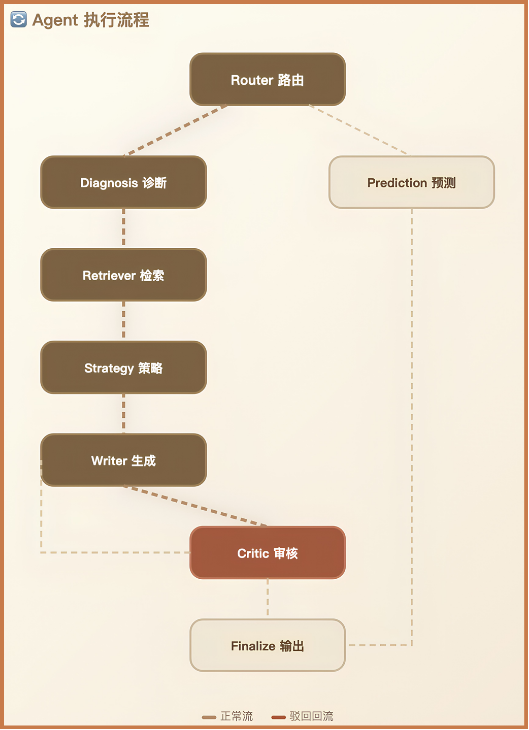

# 大学生体测健康：大模型领域微调与个性化方案系统

> 基于 LoRA 两阶段微调（SFT + DPO）的 Qwen2.5-7B，解决通用大模型在学生体测健康干预上"专业度不足、千人一面"的问题，实现基于体测数据的个性化健康方案生成。

[](LICENSE)
[](#引用)
[](#数据说明)
[](#模型权重)

## 项目背景

本项目是面向**大学生健康场景的大模型领域微调与落地项目**。

最初的问题是：手上有 **3.6 万名大学生连续四年的体测成绩**，但一直没有被很好地利用；通用大模型虽然能做健康咨询，但**不懂高校体测标准，也无法结合学生四年的体质变化给出针对性方案**，输出的建议普遍泛泛而谈、千人一面。

因此，本项目的目标是：**构建一个专门适配大学生体测健康场景的垂直领域模型，并将其封装为可直接使用的端到端系统**，最终实现基于体测数据的个性化健康方案生成。

整体技术路径分三步：

```
数据构造 ──→ 两阶段微调（SFT → DPO）──→ 流程化落地（LangGraph 多智能体）
```

---

## 一、数据准备

### 1. 自定义健康指数 HI

基于《国家学生体质健康标准》，自定义核心评估指标 **HI（健康指数）**：不只使用单次体测的绝对分数，还结合学生大一到大四的成绩**变化趋势**，加权计算综合健康分。

### 2. 规则库与数据合成

原始数据只有体测成绩、没有干预行为记录。为此，基于运动健康领域的先验规则，构建**「干预动作 → 体测指标变化」的映射规则库**（有氧训练对应肺活量/耐力提升、力量训练对应握力/力量提升、作息不规律对应耐力下降等），并基于规则库模拟学生大一到大四的状态变化，生成「体测状态 → 健康评估 → 干预建议 → 后续状态」的多轮样本，统一整理为标准的 `system / user / assistant` 格式。

### 3. 数据规模与质量

| 数据集 | 规模 | 说明 |
|--------|------|------|
| SFT 监督数据 | **约 10 万条**（101,860） | 覆盖分类、预测、推荐、知识问答 4 类任务 |
| DPO 偏好样本对 | **约 1 万条**（8,660） | 每条含好答案（chosen）与坏答案（rejected） |

- **质量保障**：对全部数据进行**规则合规检查**，包括弱指标识别、禁忌词、处方合理性（见 `code/31_compliance_check.py`）；并进行**人工抽样评定**方案合理性。
- **数据范围**：所有数据均只针对**体测呈退化趋势**的学生群体（干预的核心目标）。
- 按 **9:1** 拆分训练集与测试集。

> 原始学生级数据涉及隐私，本仓库不发布，仅提供聚合统计，详见[数据说明](#数据说明)。

---

## 二、两阶段微调：SFT 与 DPO

- **基座模型**：`Qwen2.5-7B-Instruct`
- **微调方式**：**LoRA 低秩适配**（r=16, lora_alpha=32, dropout=0.05），在保证效果的同时控制算力与显存成本。

### 第一阶段：SFT 监督微调 —— 解决"懂不懂"

用约 10 万条领域对话数据训练，让模型学会标准的体测评估逻辑与个性化干预方案的生成范式，把通用大模型转化为"懂学生体测"的领域模型。

### 第二阶段：DPO 偏好优化 —— 解决"好不好"

SFT 后模型已能输出方案，但质量不稳定。用标注好的偏好对（好方案 vs 空泛/张冠李戴/错误方案）做 DPO 对齐，让模型更倾向于输出**针对性强、合规、安全**的干预方案。

### 训练配置

| 配置 | SFT | DPO |
|------|-----|-----|
| LoRA | r=16 / alpha=32 / dropout=0.05 | 在 SFT 模型上继续 |
| 最大长度 | 256 | 256 |
| 有效批大小 | 64 | 16 |
| 轮数 | 3 epochs | 1 epoch |
| 学习率 | 1e-4 | 5e-6 |
| 其他 | bf16、梯度检查点、断点续训 | beta=0.1、标签平滑、重复率退化检测 |

---

## 三、评估

### 评估指标

围绕"个性化"这一核心，在**同一批测试问题**上对比基线模型与微调模型：

| 指标 | 含义 |
|------|------|
| **弱指标识别准确率** | 能否准确找对学生真正薄弱的指标 |
| **处方对症率** | 推荐的训练类型是否匹配薄弱指标 |
| **方案多样性** | 对不同学生是否生成差异化方案（而非千人一面） |
| **合规率** | 弱指标、禁忌词、处方合理性等规则综合通过 |
| **人工合理性评分** | 抽样盲评方案的针对性、可执行性、科学合理性 |

### 评估结果

以**未微调的 Qwen2.5-7B-Instruct 为基线**，在同一批测试问题上：

<table>
<thead>
<tr><th align="left">模型</th><th>弱指标识别</th><th>处方对症</th><th>多样性</th><th>综合合规率</th></tr>
</thead>
<tbody>
<tr><td align="left">基线 Qwen2.5-7B</td><td>48%</td><td>46%</td><td>35%</td><td>38%</td></tr>
<tr><td align="left"><b>SFT</b></td><td colspan="4">各指标相对基线提升约 <b>35%</b></td></tr>
<tr><td align="left"><b>DPO</b></td><td colspan="4">各指标相对基线提升约 <b>45%</b></td></tr>
</tbody>
</table>

- 基线模型的内容**安全性**较好，但面对体测数据倾向于给出"面面俱到的通用模板"，难以精准锁定薄弱指标；
- SFT 后模型具备领域评估与方案生成能力；DPO 后方案更对症、更具体、更稳定。

---

## 四、多智能体系统（LangGraph）

模型训练完成后，基于 **LangGraph** 搭建流程编排式多节点智能体系统，将健康咨询流程标准化。核心为四个节点：

```
输入诊断 ──→ 策略生成 ──→ 质量审核 ──→ 结果输出
```



- **策略生成**：调用微调好的领域模型生成干预方案；
- **质量审核**：由规则引擎兜底校验（指标匹配、安全剂量、禁忌症、方案完整度）；
- **打回机制**：若质量审核**不通过**，则**打回撰写节点重新生成方案，并重新进入审核**（最多重试 2 轮，防止死循环），通过后才输出结果。

实际工程中做了更细的拆分，共 8 个节点：`router（路由）→ diagnosis（诊断）→ retriever（知识检索）→ strategy（策略）→ writer（撰写）→ critic（审核）→ finalize（输出）`，并对预测类任务单独分流。

---

## 仓库结构

```
health-rag-student-fitness/
├── code/                     # 实验脚本 + HealthAgent 应用
│   ├── 01_*.py ~ 31_*.py     # 数据构建、SFT/DPO、评估、合规检查
│   ├── health_agent/         # LangGraph 多智能体系统（Flask + 网页 Demo）
│   └── m3_agentic_rl/        # 干预效果模拟器（规则合成环境）
├── results/                  # 聚合实验结果（无学生级数据）
├── knowledge_base/
│   └── chunks/               # 453 块公开健康知识 + INDEX.json
├── scripts/                  # 工具脚本（ModelScope 上传等）
├── assets/                   # 图表等静态资源
├── README.md
├── LICENSE                   # MIT
├── CITATION.cff              # 引用元数据
└── requirements.txt          # Python 依赖
```

## 快速开始

```bash
git clone https://github.com/LLLLLZ-529/health-rag-student-fitness.git
cd health-rag-student-fitness
python -m venv .venv
source .venv/bin/activate      # Windows: .venv\Scripts\activate
pip install -r requirements.txt
```

运行 HealthAgent 网页 Demo（需先下载模型权重）：

```bash
cd code/health_agent
python server.py               # 浏览器打开 http://localhost:5000
```

## 数据说明

> 本仓库**仅包含聚合统计**。原始学生级数据（含 `student_id`、性别、民族、个人体测明细）因涉及学生隐私**不予公开**。

原始数据集为 **36,059 名本科生**连续 4 年体质健康测试数据，每年 7 项指标（BMI、肺活量、50m 跑、立定跳远、坐位体前屈、耐力跑、力量）。字段说明与 HI 计算逻辑见 `code/` 下相关脚本，可用自己的数据复现。

## 模型权重

LoRA 适配器权重（基于 Qwen2.5-7B-Instruct 的 SFT 与 DPO 微调，各约 165 MB）托管在 **ModelScope**：

- **SFT 适配器**：https://modelscope.cn/models/anne118/health-rag-sft-7b
- **DPO 适配器**：https://modelscope.cn/models/anne118/health-rag-dpo-7b

```bash
pip install modelscope
modelscope download anne118/health-rag-sft-7b --local_dir models/sft_best_model
modelscope download anne118/health-rag-dpo-7b --local_dir models/dpo_model
```

基础模型 Qwen2.5-7B-Instruct 首次运行时自动从 ModelScope 下载。

## 知识库

本仓库包含来自公开政府与 WHO 出版物的 **453 块**知识（完整知识库约 2600 块，因版权问题未公开），按四类组织：运动处方、膳食营养、体测标准、健康政策。完整清单见 `knowledge_base/chunks/INDEX.json`，来源说明见 `knowledge_base/README.md`。

## 引用

如使用本仓库代码或结果，请引用：

```bibtex
@misc{healthrag2026,
  title={Domain-Specific Fine-Tuning of Large Language Models for Personalized Student Physical Health Intervention},
  author={Project Contributors},
  year={2026},
  note={Manuscript in preparation}
}
```

## 许可证

- **代码**：MIT License
- **论文材料**：撰写中，暂未公开
- **知识库**：来自公开政府 / WHO 出版物，许可条款以原文为准
